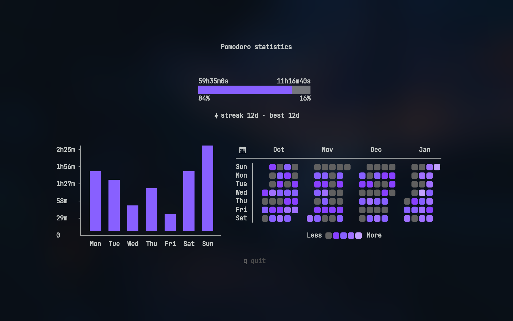
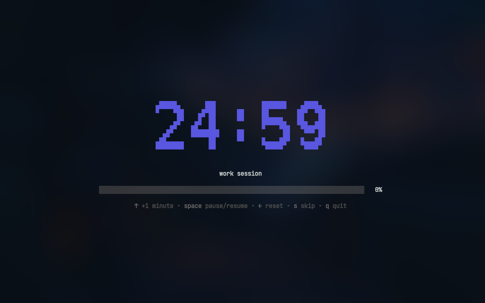
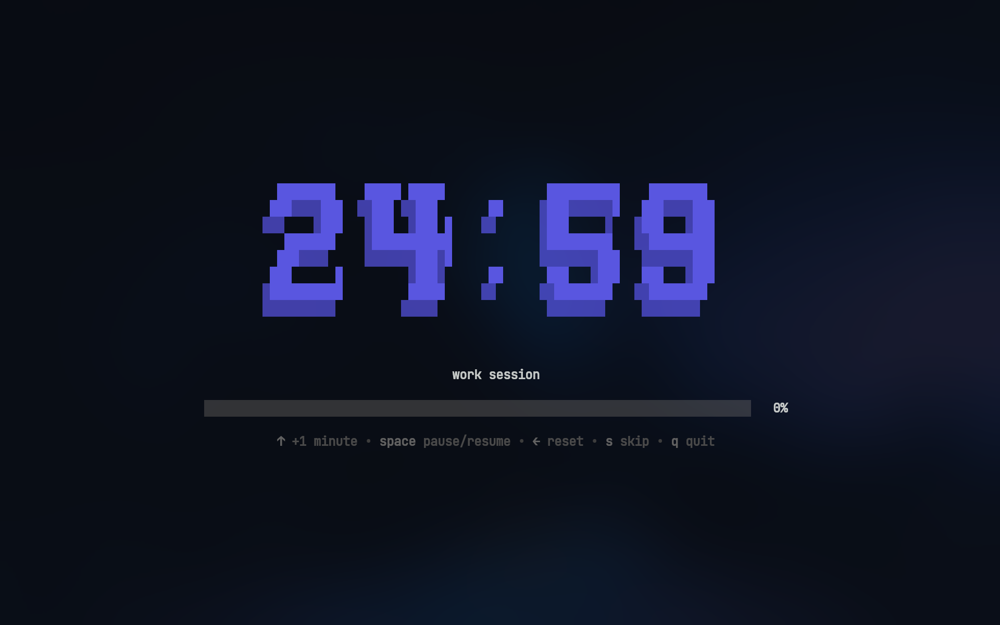
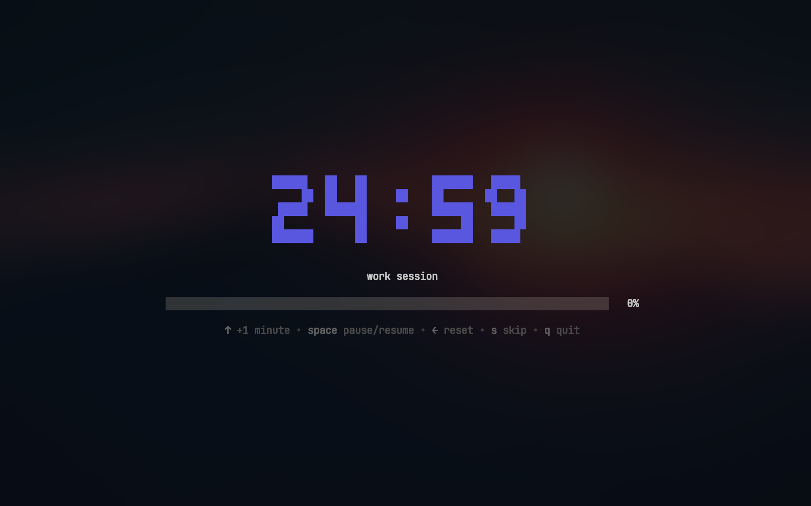
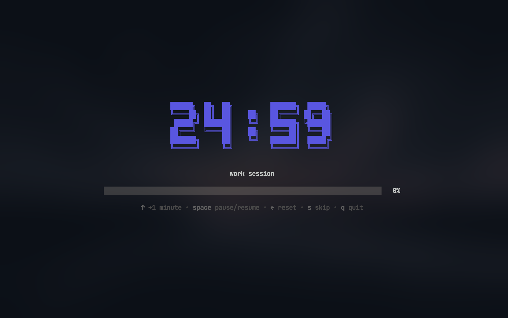

# pomo — Terminal Pomodoro Timer


A simple, customizable Pomodoro timer for your terminal, built with [Bubble Tea](https://github.com/charmbracelet/bubbletea).

## Features

- 🍅 Work and break timer sessions
- 🔄 Pomodoro cycles with long break
- 🔗 Task chaining with user confirmation prompts
- 📊 Real-time progress bar visualization
- ⌨️ Keyboard shortcuts to adjust time mid-session
- ⏸️ Pause and resume sessions
- ⏭️ Skip to next session
- 🔔 Cross-platform desktop notifications
- 🎨 Clean, minimal terminal UI with ASCII art timer fonts
- 🛠️ Custom commands when timers complete

### Statistics

Track your productivity with `pomo stats`:

- **Duration ratio** — total work vs break time
- **Weekly bar chart** — daily work hours for the past 7 days
- **4-month heatmap** — GitHub-style activity visualization

> Heatmap icons require a [Nerd Font](https://www.nerdfonts.com/)



### Desktop Notifications

pomo sends native desktop notifications when sessions complete.

## Timer Fonts

<!-- prettier-ignore -->
|              **mono12**              |                  **rebel**                   |
| :----------------------------------: | :------------------------------------------: |
|  |                        |
|               **ansi**               |                **ansiShadow**                |
|       |  |

## Usage

Work sessions:

```bash
pomo                    # work session
pomo 30m                # 30m work session
pomo 45m 15m            # 45m work with 15m break
pomo -t "write report"  # work session with custom title (or --title)
```

Break sessions:

```bash
pomo break              # break session
pomo break 10m          # 10m break session
```

View statistics:

```bash
pomo stats              # View your productivity stats
```

## Installation

### Windows

**Prerequisite:** [Go 1.23+](https://go.dev/dl/) (or `winget install GoLang.Go`)

```powershell
go install github.com/RahmanRagib/pomo@latest

# the binary lands in %USERPROFILE%\go\bin — make sure it's on PATH
pomo
```

Or build from source:

```powershell
git clone https://github.com/RahmanRagib/pomo
cd pomo
go build -o "$env:USERPROFILE\go\bin\pomo.exe" .
```

### Arch Linux

Install Go from the official repos:

```bash
sudo pacman -S --needed go git
```

Then install:

```bash
go install github.com/RahmanRagib/pomo@latest

# make sure ~/go/bin is on your PATH
echo 'export PATH="$PATH:$HOME/go/bin"' >> ~/.bashrc
source ~/.bashrc
```

Or build from source:

```bash
git clone https://github.com/RahmanRagib/pomo
cd pomo
go build -o ~/.local/bin/pomo .
```

## Configuration

<details>
<summary>📁 Config file search order</summary>

pomo looks for its config file in the following order:

1. **Current directory**: `pomo.yaml` (highest priority)
2. **System config directory**:
   - **Linux**/**macOS**: `~/.config/pomo/pomo.yaml`
   - **Windows**: `%APPDATA%\pomo\pomo.yaml`
3. **Built-in defaults** if no config file is found

</details>

Example `pomo.yaml`:

```yaml
# action to take after session completion
# options: "ask" | "start" | "quit"
onSessionEnd: "ask"

asciiArt:
  # use ASCII art for timer display
  enabled: true

  # available fonts: "mono12" | "rebel" | "ansi" | "ansiShadow"
  # default: mono12
  font: ansiShadow

  # color of the ASCII art timer
  # hex color or "none"
  color: "#5A56E0"

work:
  duration: 25m
  title: work session

  # cross-platform notifications
  notification:
    enabled: true
    urgent: true # persistent notification with alert sound (platform-dependent)
    title: work finished 🎉
    message: time to take a break

break:
  duration: 5m

  # will run after the session ends
  then:
    - [spd-say, "Back to work!"]

longBreak:
  # enable long break after a certain number of work sessions
  enabled: true

  # number of work sessions before long break
  after: 4

  # long break duration
  duration: 15m
```

Check out [pomo.yaml](pomo.yaml) for a full example with all options.

### Sound Notifications

You can play sounds when sessions complete by running commands in the `then` section.

```yaml
work:
  then:
    - [paplay, ~/sounds/work-done.mp3] # Linux
    # - [powershell, start, work-done.mp3] # Windows
```

> Commands run with a 5 second timeout and are automatically cancelled when starting the next session.

### Key Bindings

#### Timer Controls

| Key            | Action                    |
| -------------- | ------------------------- |
| `↑` / `k`      | Increase time by 1 minute |
| `Space`        | Pause/Resume timer        |
| `←` / `h`      | Reset to initial duration |
| `s`            | Skip to next session      |
| `q` / `Ctrl+C` | Quit                      |

> Skip button skips directly to the next session, bypassing any prompts

#### Confirmation Dialog

| Key            | Action                          |
| -------------- | ------------------------------- |
| `y`            | Confirm (Yes)                   |
| `n`            | Cancel (No)                     |
| `s`            | Start short session (2 minutes) |
| `Tab`          | Toggle selection                |
| `Enter`        | Submit choice                   |
| `q` / `Ctrl+C` | Quit                            |

> Short sessions extend the current session by 2 minutes, useful when you need a bit more time

## Acknowledgments

Forked from [Bahaaio/pomo](https://github.com/Bahaaio/pomo) — thanks to Bahaa El Deen Mohamed for the original project.

## License

This project is licensed under the MIT License. See the [LICENSE](LICENSE) file for details.
